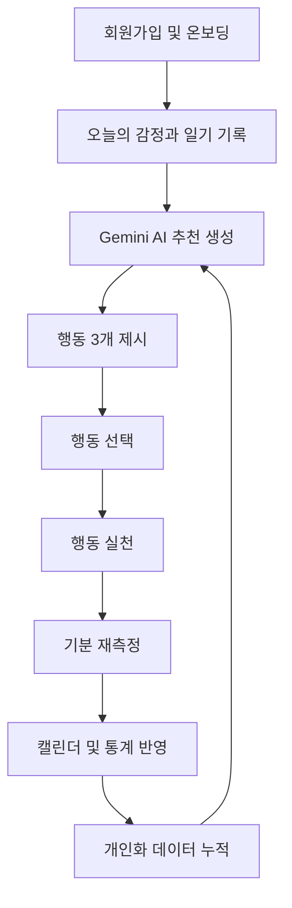
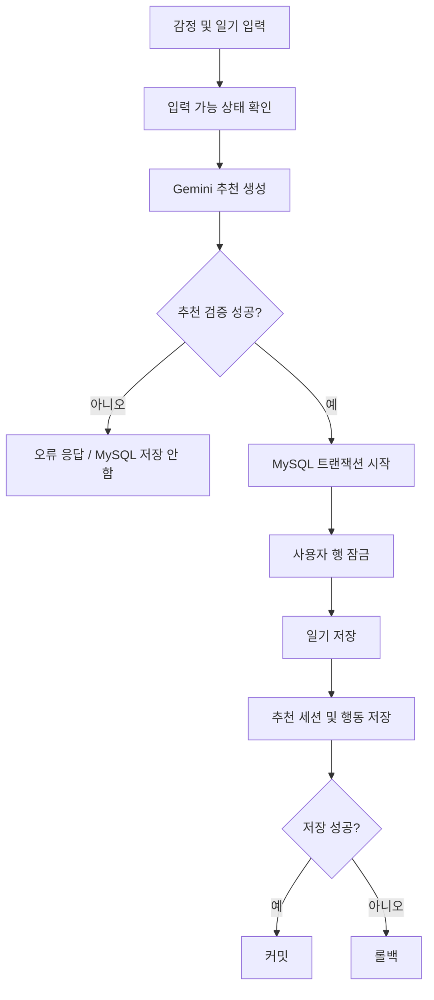
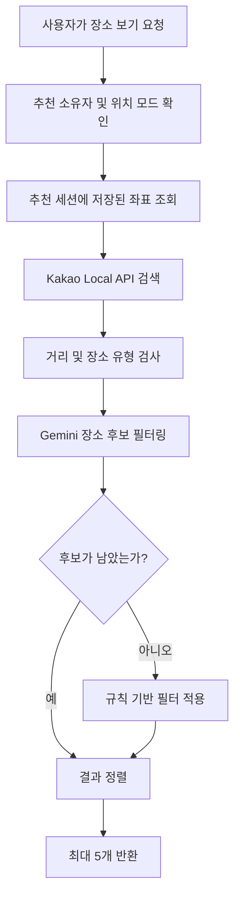
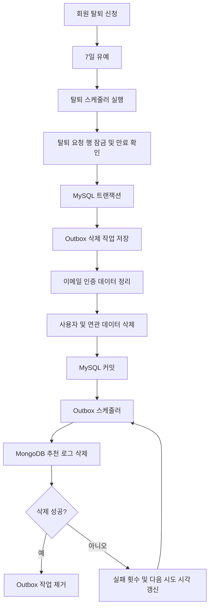
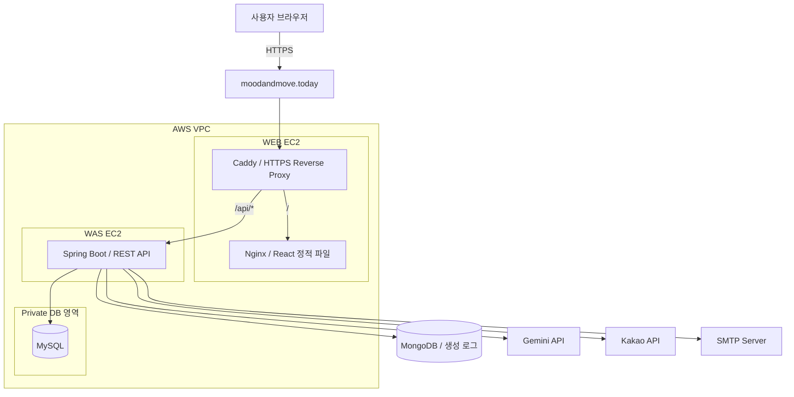
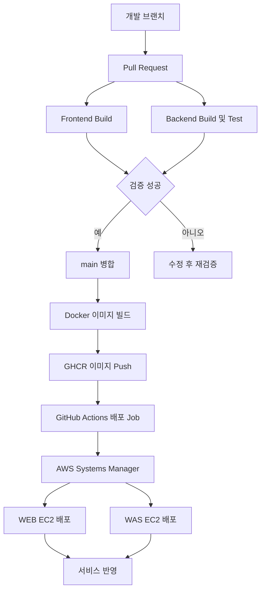

<div align="center">

# 🌿 Mood & Move

### 오늘의 마음을 기록하고, 나에게 맞는 다음 행동을 찾다.

**감정 기록 · AI 행동 추천 · 행동 전후 기분 변화 · 개인화 통계**


**[🌐 서비스 바로가기](https://moodandmove.today)**

[서비스 소개](#-서비스-소개) · [주요 기능](#-주요-기능) · [핵심 설계](#-핵심-설계) · [인프라](#-인프라-및-배포-아키텍처) · [실행 방법](#-로컬-실행)

</div>

---

## 📖 서비스 소개

**Mood & Move는 사용자의 감정 기록을 실제 행동으로 연결하는 AI 기반 웰니스 서비스입니다.**

사용자가 오늘의 감정과 일기를 작성하면 AI가 현재 상황과 개인의 선호를 분석하여 실천 가능한 행동 세 가지를 추천합니다.

사용자는 추천된 행동 중 하나를 선택하여 실천하고, 이후 기분을 다시 측정할 수 있습니다.

재측정 결과는 통계로 누적되며 다음 추천의 개인화 자료로 활용됩니다.

단순히 활동을 추천하는 것에서 끝나지 않고, **내가 실제로 어떤 행동을 했으며 그 행동이 기분에 어떤 변화를 주었는지 확인할 수 있도록 설계했습니다.**

| 구분 | 내용 |
| --- | --- |
| 프로젝트명 | Mood & Move |
| 개발 형태 | 3인 팀 프로젝트 |
| 개발 기간 | 2026.09.29 ~ 2026.10.16 |
| 팀원 | 이래원 · 백기완 · 장준호 |
| 서비스 형태 | 반응형 웹 서비스 |
| 주요 기술 | React, Spring Boot, MySQL, MongoDB, Gemini |
| 배포 환경 | AWS EC2, Docker, Nginx, Caddy |
| CI/CD | GitHub Actions, GHCR, AWS Systems Manager |
| 서비스 주소 | https://moodandmove.today |

### 프로젝트 목표

- 감정 기록과 행동 추천을 하나의 사용자 경험으로 연결
- LLM을 활용한 상황 기반 행동 추천 구현
- 행동 전후의 기분 변화를 정량적으로 기록
- 누적된 행동 효과를 다음 AI 추천에 반영
- 데이터의 정합성을 고려한 백엔드 설계
- 실제 도메인과 HTTPS 환경을 갖춘 웹 서비스 배포

---

## ✨ 주요 기능

| 번호 | 기능 | 설명 |
| --- | --- | --- |
| 01 | 회원가입 및 로그인 | 이메일 인증, 일반 로그인, 카카오 소셜 로그인 |
| 02 | 인증 및 세션 관리 | JWT HttpOnly 쿠키 인증, Access/Refresh Token 재발급, CSRF 보호 및 로그아웃 |
| 03 | 온보딩 | 나이대, 성별, 취미, 활동 성향, 환경 및 동행 선호 설정 |
| 04 | 감정 및 일기 기록 | 감정, 강도, 현재 활동, 일기 내용, 위치 사용 방식 입력 |
| 05 | AI 행동 추천 | Gemini를 활용한 현재 상황 기반 행동 3개 추천 |
| 06 | 주변 장소 조회 | Kakao Local API 기반 반경 5km 이내 장소 최대 5곳 조회 |
| 07 | 행동 선택 및 실행 | 추천 행동 선택, 실행 정보 저장 및 상태 관리 |
| 08 | 기분 재측정 | 행동 전후 기분 점수 비교 및 변화량 기록 |
| 09 | 캘린더 및 통계 | 월별 감정 기록, 행동 빈도, 개인화 점수 및 기분 변화 확인 |
| 10 | 마이페이지 | 프로필, 취미, 선호, 비선호 행동 및 계정 관리 |
| 11 | 비밀번호 재설정 | 이메일 인증을 통한 비밀번호 재설정 |
| 12 | 월간 이메일 리포트 | 지난달 감정·행동 통계와 AI 응원 메시지 발송 |
| 13 | 회원 탈퇴 및 복구 | 7일 유예, 계정 복구, MySQL·MongoDB 데이터 정리 |

### 서비스 이용 흐름



---

## 🧠 핵심 설계

### 1. 일기의 현재 상황을 우선하는 AI 행동 추천

사용자의 과거 취미나 선호만으로 추천하면 지금 당장 필요한 행동과 다른 결과가 나올 수 있습니다.

이를 방지하기 위해 **사용자가 작성한 일기의 현재 상황을 추천의 우선 조건**으로 사용했습니다.

추천 시 고려하는 주요 정보는 다음과 같습니다.

- 현재 감정 및 감정 강도
- 사용자가 작성한 일기
- 현재 하고 있는 활동
- 시간대와 사용 가능한 시간
- 선호하는 활동 환경 및 활동 성향
- 동행 선호
- 비선호 행동
- 과거 재측정 결과에 따른 카테고리별 점수

AI가 생성한 결과를 그대로 저장하지 않고 서버에서 유효성을 검증합니다.

**서버 검증 항목**

- 허용된 행동 카테고리인지 확인
- 활동 환경·성향·동행 조건 검증
- 추천 소요 시간 검증
- 행동 이름 및 중복 여부 확인
- 비선호 행동 검사
- 장소 검색 정보 유효성 확인
- 최종 추천 행동 3개 확보 여부 확인

검증을 통과하지 못한 추천은 정상적인 추천 결과로 저장하지 않습니다.

### 2. 행동 전후 기분 변화를 활용하는 개인화

Mood & Move의 개인화는 단순 클릭 횟수가 아니라 **실제로 완료한 행동의 재측정 결과**를 활용합니다.

사용자가 행동을 실천한 뒤 기분을 다시 측정하면 행동 효과 데이터를 누적합니다.

이를 통해 다음 정보를 계산합니다.

- 행동 전후 평균 기분 변화량
- 긍정적인 변화가 발생한 비율
- 유효 재측정 표본 수
- 카테고리별 개인화 점수

개인화 점수는 평균 변화량과 긍정 변화 비율을 조합하고, 표본 수에 따라 효과 점수의 반영 비중을 조절합니다.

표본이 부족할 때는 중립 점수인 50점에 가깝게 유지하며 데이터가 누적될수록 실제 행동 효과를 더 반영합니다.

**재측정 표본 수에 따른 추천 유형**

| 유효 표본 수 | 추천 유형 | 설명 |
| --- | --- | --- |
| 0~2개 | `COLD_START` | 현재 상황과 사용자 선호 중심 추천 |
| 3~9개 | `HYBRID` | 현재 상황과 초기 행동 효과를 함께 반영 |
| 10개 이상 | `PERSONALIZED` | 누적된 행동 효과 데이터를 적극 활용 |

이 기능은 AI 모델을 직접 재학습시키는 방식이 아닙니다.

**MySQL에 저장된 행동 효과 통계를 다음 Gemini 요청의 입력 맥락으로 전달하는 방식**입니다.

### 3. 일기와 AI 추천의 트랜잭션 분리

초기 설계에서 고려한 문제는 AI 추천 생성 실패와 데이터 저장의 불일치였습니다.

예를 들어 일기만 저장되고 AI 추천이 실패하면 사용자는 정상적으로 기록이 완료됐다고 생각하지만 추천을 진행하지 못할 수 있습니다.

이를 방지하기 위해 AI 호출과 데이터 저장을 분리했습니다.



**설계 핵심**

1. Gemini API 응답을 기다리는 동안 MySQL 트랜잭션을 유지하지 않습니다.
2. AI 응답 생성과 검증이 끝난 뒤 DB 저장을 시작합니다.
3. 같은 사용자의 동시 저장 요청을 제어하기 위해 사용자 행 잠금을 사용합니다.
4. 일기와 추천 데이터는 하나의 MySQL 트랜잭션에서 저장합니다.
5. 저장에 실패하면 해당 트랜잭션을 롤백합니다.

MongoDB의 추천 생성 로그는 MySQL과 별도 저장소이므로 독립적으로 기록하며, 로그 저장 오류가 추천 기능 전체를 중단시키지 않도록 처리합니다.

### 4. 위치 기반 장소 조회와 AI 추천의 분리

AI 행동 추천과 실제 주변 장소 검색을 별도의 기능으로 구성했습니다.

사용자가 위치 정보 사용에 동의하지 않더라도 카페에서 독서하기, 공원 산책하기 같은 행동을 추천받을 수 있습니다.

단, 현재 위치를 활용한 주변 장소 검색은 수행하지 않습니다.

| 위치 모드 | 동작 |
| --- | --- |
| `CURRENT` | 추천 생성 당시 전달한 현재 위치 사용 |
| `SAVED` | 사용자가 설정한 기본 활동 지역 사용 |
| `NONE` | 위치 기반 주변 장소 검색 수행하지 않음 |

**장소 검색 흐름**



- 최대 검색 반경: 5km
- 최대 반환 결과: 5개
- 장소 유형과 키워드에 따라 검색
- Gemini 필터링 결과가 없으면 규칙 기반 필터 사용
- 추천 세션에 저장된 위치를 사용하여 조회 기준의 일관성 유지

장소 검색 결과는 실제 예약 가능 여부나 공연 일정을 보장하지 않습니다.

### 5. MySQL과 MongoDB의 역할 분리

서로 다른 성격의 데이터를 적합한 저장소에 분리했습니다.

| 저장소 | 역할 | 주요 데이터 |
| --- | --- | --- |
| MySQL | 핵심 서비스 데이터 관리 | 사용자, 선호, 감정 기록, 행동 추천, 실행, 재측정, 통계 |
| MongoDB | AI 추천 생성 과정 추적 | 요청·응답, 모델 정보, 처리 시간, 추천 생성 상태, 실패 단계 |
| Flyway | MySQL 스키마 버전 관리 | 테이블, 제약조건, 인덱스, 기준 데이터 마이그레이션 |

MySQL에서는 Spring Data JPA를 통해 엔티티와 관계형 데이터를 관리합니다.

MongoDB에서는 Spring Data MongoDB를 활용하여 추천 생성 로그를 문서 형태로 저장합니다.

이러한 분리는 핵심 데이터의 관계와 무결성을 MySQL에서 유지하면서, LLM 호출 과정의 다양한 로그 정보를 유연하게 관리하기 위한 설계입니다.

### 6. 회원 탈퇴 시 MySQL·MongoDB 데이터 정합성 관리

회원 탈퇴 데이터는 MySQL과 MongoDB에 나누어 저장돼 있습니다.

일반적인 `@Transactional`만으로는 두 데이터베이스의 삭제 작업을 하나의 트랜잭션으로 처리할 수 없습니다.

이를 해결하기 위해 **Transactional Outbox 기반의 비동기 삭제 구조**를 적용했습니다.

**기존 방식의 문제**

- MongoDB 추천 로그 삭제 성공
- 이후 MySQL 사용자 삭제 실패
- MySQL은 롤백되지만 MongoDB 데이터는 이미 삭제됨

**개선 구조**



**구현 특징**

- 회원 탈퇴 신청 후 7일간 유예
- 유예기간 내 계정 복구 가능
- 탈퇴 요청 행에 잠금을 적용하여 복구와 삭제의 동시 실행을 제어
- MySQL 사용자 삭제와 Outbox 저장을 동일한 트랜잭션으로 처리
- 이메일 인증 및 비밀번호 재설정 데이터 별도 정리
- MySQL 커밋 후 MongoDB 추천 로그 삭제
- MongoDB 오류 발생 시 실패 횟수와 다음 재시도 시각 저장
- 지수 백오프 방식으로 재시도 간격 조정
- 사용자별 삭제 처리로 일부 실패가 다른 사용자 삭제에 미치는 영향 축소

관련 코드:

- `AccountDeletionService`
- `AccountDeletionOutboxProcessor`
- `UserWithdrawalScheduler`
- `AccountDeletionOutboxScheduler`
- `AccountDeletionOutboxRepository`

스키마는 Flyway `V10__create_account_deletion_outbox.sql`에서 관리합니다.

이 구조는 두 데이터베이스에 분산 트랜잭션을 적용하는 대신 **Outbox에 남은 작업을 반복 처리해 최종적으로 정리하는 방식**입니다.

실제 DB 동시성 및 장애 복구 통합 테스트는 추가 검증 과제로 남아 있습니다.

### 7. JWT 쿠키 기반 인증 및 CSRF 보호

Spring Security와 JWT를 이용하여 인증을 구현했습니다.

- Access Token과 Refresh Token 발급
- `HttpOnly` 쿠키에 토큰 저장
- `SameSite=Lax` 설정
- 운영 환경에서 `Secure` 쿠키 설정 지원
- Access Token 만료 시 Refresh Token을 사용한 자동 재발급
- Refresh Token 회전
- 로그아웃 및 비밀번호 변경 시 기존 인증 상태 무효화
- 사용자 인증 여부에 따른 API 접근 제어

쿠키 기반 인증에서 발생할 수 있는 CSRF 공격을 방어하기 위해 Spring Security의 CSRF 보호를 적용했습니다.

- `XSRF-TOKEN` 쿠키 발급
- 상태 변경 요청에서 `X-XSRF-TOKEN` 헤더 검증
- 프론트엔드의 `csrfFetch()`가 CSRF 쿠키 값을 읽어 요청 헤더에 자동 첨부
- 기존 인증 공통 요청 함수인 `authFetch()` 내부에서 `csrfFetch()`를 사용하도록 연결
- `/api/csrf` 엔드포인트를 통해 CSRF 토큰 초기화
- 로그아웃 등 인증 관련 상태 변경 요청에도 CSRF 검증 적용
- Access Token 재발급 이후 기존 요청을 자동 재시도하는 인증 흐름 유지

또한 로그인 및 일반 계정 복구에는 실패 횟수 제한을 적용했습니다.

| 구분 | 정책 |
| --- | --- |
| 제한 기준 | 클라이언트 IP + 정규화된 이메일 |
| 제한 시간 | 10분 |
| 실패 허용 횟수 | 5회 |
| 제한 시 응답 | HTTP 429 |
| 저장 방식 | Caffeine 기반 인메모리 캐시 |

현재 제한 상태는 애플리케이션 인스턴스별 메모리에서 관리되므로 재시작 및 다중 WAS 환경을 고려한 Redis 등 공용 저장소 전환은 추후 개선 과제입니다.

---

## 🛠 기술 스택

### Application

| 영역 | 기술 |
| --- | --- |
| Language | Java 21, JavaScript |
| Backend | Spring Boot 4.1.1, Spring Web MVC, Gradle |
| Security | Spring Security, JWT, JJWT, BCrypt, CSRF Protection |
| ORM / Data Access | Spring Data JPA |
| Database | MySQL 8, MongoDB |
| Database Migration | Flyway |
| Cache / Rate Limit | Caffeine |
| Frontend | React 19, Vite 8, React Router 7 |
| UI / Visualization | CSS, Recharts 3, React Hot Toast |
| Testing | JUnit 5, Spring Boot Test, Mockito |
| External API | Gemini API, Kakao Local API, Kakao OAuth, Kakao Maps JavaScript API |
| Email | Spring Mail, SMTP |

### Infrastructure & DevOps

| 영역 | 기술 | 역할 |
| --- | --- | --- |
| Cloud | AWS EC2 | WEB, WAS, DB 서버 분리 |
| Networking | AWS VPC | 네트워크 및 서버 간 접근 구분 |
| Web Proxy / HTTPS | Caddy | HTTPS 처리 및 요청 라우팅 |
| Frontend Web Server | Nginx | React 정적 파일 제공 |
| Container | Docker | 애플리케이션 컨테이너 실행 |
| CI/CD | GitHub Actions | 빌드, 테스트 및 배포 자동화 |
| Image Registry | GitHub Container Registry | Docker 이미지 저장 |
| Remote Deployment | AWS Systems Manager | EC2 배포 명령 실행 |
| Domain | moodandmove.today | 서비스 접속 도메인 |

---

## ☁️ 인프라 및 배포 아키텍처

### 1. 전체 인프라 구성

프론트엔드와 백엔드, 데이터베이스의 역할을 분리한 구조입니다.

WEB EC2에서는 Caddy와 Nginx 컨테이너를 사용합니다.

Caddy는 외부 HTTPS 요청을 받아 요청 경로에 따라 프론트엔드 또는 백엔드로 전달합니다.



MongoDB는 `MONGODB_URI`로 연결되는 별도 로그 저장소이며, 구체적인 접속 대상은 실행 환경 설정에 따릅니다.

### 2. 서버별 역할

| 서버 | 구성 요소 | 주요 역할 |
| --- | --- | --- |
| WEB EC2 | Caddy, Nginx, React | HTTPS 요청 처리, 정적 파일 제공, 리버스 프록시 |
| WAS EC2 | Java 21, Spring Boot | 인증, 회원 관리, 감정 기록, 추천, 통계 및 배치 처리 |
| DB 영역 | MySQL | 핵심 서비스 데이터 저장 |
| MongoDB 저장소 | MongoDB | AI 추천 생성 로그 관리 |

프론트엔드는 Vite로 빌드한 정적 파일을 Nginx에서 제공합니다.

따라서 운영 환경에서 Vite 개발 서버를 실행하는 방식이 아닙니다.

### 3. 실제 요청 흐름

**프론트엔드 요청**

```text
사용자
  ↓ HTTPS
moodandmove.today
  ↓
Caddy (WEB EC2)
  ↓
Nginx 컨테이너
  ↓
React 정적 파일 응답
```

**API 요청**

```text
사용자
  ↓ HTTPS /api/*
moodandmove.today
  ↓
Caddy (WEB EC2)
  ↓
Spring Boot (WAS EC2)
  ↓
Service / Repository
  ↓
MySQL 또는 MongoDB
```

현재 운영 Caddy 구성에서는 `/api` 요청을 Spring Boot로 직접 전달합니다.

Nginx 설정에도 API 프록시 경로가 정의돼 있지만 일반적인 운영 HTTPS 진입 경로는 Caddy를 기준으로 동작합니다.

Caddy 운영 설정과 EC2의 실제 배포 스크립트는 GitHub 저장소 밖에서 관리합니다.

### 4. 네트워크 설계 목적

WEB, WAS, DB를 분리한 이유는 각 계층의 역할과 접근 범위를 명확하게 하기 위해서입니다.

- 외부 사용자는 웹 진입점으로 HTTPS 요청
- API 요청은 WEB 프록시를 거쳐 WAS로 전달
- 데이터베이스는 애플리케이션에서만 접근하도록 설계
- 프론트엔드 빌드 결과와 백엔드 애플리케이션을 별도로 관리
- 각 서비스의 배포 및 장애 원인을 구분하기 쉬운 구조

민감한 비밀번호, DB 접속 URI, API 키 등은 저장소에 포함하지 않고 별도의 환경변수로 관리합니다.

---

## 🚀 CI/CD 파이프라인

GitHub Actions와 GitHub Container Registry, AWS Systems Manager를 이용하여 배포를 자동화했습니다.

### 1. 배포 흐름



### 2. GitHub Actions 동작

**Pull Request 생성 시**

- Node.js 22 환경 구성
- `npm ci` 실행
- React 프로덕션 빌드
- 프론트엔드 Docker 이미지 빌드 확인
- Java 21 환경 구성
- `./gradlew build`로 백엔드 빌드 및 테스트 실행
- 백엔드 Docker 이미지 빌드 확인

**main 브랜치 Push 시**

- 동일한 프론트엔드 및 백엔드 검증 수행
- GHCR에 Docker 이미지 업로드
- `latest` 및 Git 커밋 SHA 기반 태그 발행
- AWS 인증
- AWS Systems Manager를 통해 EC2 배포 스크립트 실행
- 배포 명령의 성공·실패 상태 확인

관련 파일:

```text
.github/workflows/main.yml
frontend/Dockerfile
backend/Dockerfile
frontend/nginx.conf
```

### 3. Docker 이미지 구성

**Frontend**

```text
Node.js 22
    ↓
npm ci
    ↓
Vite Build
    ↓
Nginx 이미지에 dist 복사
    ↓
Nginx 실행
```

**Backend**

```text
Eclipse Temurin JDK 21
    ↓
Gradle bootJar
    ↓
실행 가능한 JAR 생성
    ↓
Eclipse Temurin JRE 21 이미지
    ↓
Spring Boot 실행
```

프론트엔드와 백엔드 모두 멀티 스테이지 Docker 빌드를 사용합니다.

### 4. 배포 시크릿 관리

GitHub Actions에서는 외부 서비스 접근에 필요한 값들을 GitHub Secrets로 전달합니다.

예를 들어 다음 값들이 배포 과정에서 사용됩니다.

- AWS 인증 정보
- 카카오 지도 JavaScript 키

애플리케이션 실행에 필요한 DB 비밀번호, JWT 서명키, SMTP 인증 정보 등은 별도의 서버 환경 설정으로 관리합니다.

`VITE_`로 시작하는 프론트엔드 환경변수는 빌드 결과에 포함될 수 있습니다. 따라서 카카오 지도 JavaScript 키는 브라우저에 공개되는 클라이언트용 키로 취급하고 Kakao Developers에서 허용 도메인을 제한해야 합니다.

### 5. 배포 관련 개선 과제

현재 파이프라인은 빌드, 테스트, Docker 이미지 게시 및 원격 배포 명령 실행을 자동화합니다.

추후 다음 기능을 보완할 계획입니다.

- 배포 후 실제 HTTP Health Check
- 서비스 장애 발생 시 자동 롤백 검증
- 프론트엔드 테스트 및 Lint를 필수 CI 단계에 포함
- 이미지 다이제스트 기반 배포 검증
- DB 자동 백업 및 복구 절차 점검
- S3를 활용한 백업 보관 정책 확립

S3 백업은 설계·개선 대상이며, 현재 저장소만으로 실제 운영 자동 백업 여부를 확인할 수 없어 완료 기능으로 표시하지 않았습니다.

---

## 🗄 데이터베이스 및 마이그레이션

### MySQL

주요 데이터는 관계형 구조로 저장합니다.

| 도메인 | 주요 테이블 |
| --- | --- |
| 회원 | `users`, `refresh_tokens`, `social_accounts` |
| 사용자 설정 | `user_preferences`, `user_hobbies`, `user_action_dislikes` |
| 감정 기록 | `mood_entries` |
| 행동 추천 | `recommendation_sessions`, `recommendations`, `recommendation_places` |
| 행동 실행 | `action_executions` |
| 행동 통계 | `action_category_scores`, `user_action_stats` |
| 회원 탈퇴 | `user_withdrawal_requests`, `account_deletion_outbox` |
| 이메일 인증 | `email_verifications`, `password_reset_verifications` |

### MongoDB

AI 추천 생성 과정을 분석하기 위한 로그를 저장합니다.

주요 추적 정보:

- 요청 식별자
- 사용자 ID
- LLM 생성 요청 및 응답 정보
- 모델 및 프롬프트 정보
- 처리 시간
- 생성 성공 또는 실패 상태
- 실패 단계 및 오류 정보

### Flyway

MySQL 스키마는 Flyway로 관리합니다.

현재 저장소에는 `V1`부터 `V10`까지 마이그레이션 파일이 포함돼 있습니다.

최신 추가 항목:

```text
V10__create_account_deletion_outbox.sql
```

애플리케이션 실행 시 Flyway가 마이그레이션 이력을 검사하고 필요한 변경을 적용합니다.

기존 운영 DB에 적용된 마이그레이션 파일은 임의로 수정하지 않고, 신규 버전의 마이그레이션을 추가하는 방식으로 관리해야 합니다.

---

## 📂 프로젝트 구조

```text
mood-and-move/
│
├── .github/
│   └── workflows/
│       └── main.yml
│
├── backend/
│   ├── Dockerfile
│   ├── build.gradle
│   ├── gradlew
│   └── src/
│       ├── main/
│       │   ├── java/com/moodandmove/
│       │   │   ├── analysis/
│       │   │   ├── calendar/
│       │   │   ├── common/
│       │   │   ├── home/
│       │   │   ├── mail/
│       │   │   ├── mood/
│       │   │   ├── place/
│       │   │   ├── recommendation/
│       │   │   ├── report/
│       │   │   └── user/
│       │   └── resources/
│       │       ├── application.properties
│       │       └── db/migration/
│       └── test/
│
├── frontend/
│   ├── Dockerfile
│   ├── nginx.conf
│   ├── package.json
│   ├── vite.config.js
│   ├── public/
│   └── src/
│       ├── api/
│       ├── components/
│       ├── pages/
│       ├── routes/
│       └── utils/
│
├── .env.example
├── .gitignore
└── README.md
```

---

## 💻 로컬 실행

### 1. 사전 준비

다음 환경이 필요합니다.

- JDK 21
- Node.js 22
- MySQL 8
- MongoDB 또는 MongoDB Atlas 접속 환경
- Gemini API 키
- Kakao Developers 애플리케이션
- SMTP 인증 정보

### 2. 저장소 클론

```bash
git clone https://github.com/addicto1122-lab/mood-and-move.git
cd mood-and-move
```

### 3. 환경변수 설정

루트 `.env.example`을 복사하여 `.env`를 생성합니다.

기본 예시:

```dotenv
# Local API Proxy
API_URL=http://localhost:8080

# Frontend
FRONTEND_URL=http://localhost:5173
COOKIE_SECURE=false

# MySQL
DB_URL=jdbc:mysql://localhost:3306/moodandmove
DB_USERNAME=your_mysql_username
DB_PASSWORD=your_mysql_password

# MongoDB
MONGODB_URI=mongodb://127.0.0.1:27017/moodandmove

# JWT
JWT_SECRET=replace_with_a_long_random_secret

# Gemini
GEMINI_API_KEY=your_gemini_api_key
GEMINI_MODEL=your_gemini_model

# Kakao
KAKAO_CLIENT_ID=your_kakao_client_id
KAKAO_CLIENT_SECRET=your_kakao_client_secret
KAKAO_REST_API_KEY=your_kakao_rest_api_key
KAKAO_REDIRECT_URI=http://localhost:8080/api/auth/kakao/callback

# SMTP
MAIL_USERNAME=your_mail_account
MAIL_PASSWORD=your_mail_app_password

# Reverse Proxy
FORWARDED_HEADERS_STRATEGY=none
```

실제 사용 가능한 API 키, 모델명 및 접속 비밀번호로 변경해야 합니다.

프론트엔드 지도용 키는 `frontend/.env.local`에 설정합니다.

```dotenv
VITE_KAKAO_MAP_JS_KEY=your_kakao_javascript_key
```

이 파일은 Vite 빌드 및 개발 서버에서 사용할 지도 키를 설정하기 위한 파일입니다.

### 4. 데이터베이스 생성

MySQL에 접속하여 데이터베이스를 생성합니다.

```sql
CREATE DATABASE moodandmove
CHARACTER SET utf8mb4
COLLATE utf8mb4_unicode_ci;
```

MongoDB 실행 또는 MongoDB Atlas 연결을 준비합니다.

MySQL 테이블 및 기준 데이터는 백엔드 기동 과정의 Flyway 마이그레이션에서 구성합니다.

### 5. 백엔드 실행

Windows PowerShell:

```powershell
cd backend
.\gradlew.bat bootRun
```

macOS / Linux:

```bash
cd backend
./gradlew bootRun
```

기본 실행 주소:

```text
http://localhost:8080
```

### 6. 프론트엔드 실행

저장소 루트에서 새 터미널을 열어 실행합니다.

```bash
cd frontend
npm ci
npm run dev
```

개발 서버 접속:

```text
http://localhost:5173
```

Vite 개발 프록시는 루트 `.env`의 `API_URL`을 사용합니다.

카카오 로그인과 지도를 사용하려면 Kakao Developers에 등록된 리다이렉트 URI 및 허용 웹 도메인이 로컬 주소와 일치해야 합니다.

---

## 🧪 테스트 및 검증

### Backend

Windows:

```powershell
cd backend
.\gradlew.bat clean build
```

macOS / Linux:

```bash
cd backend
./gradlew clean build
```

테스트만 실행:

```bash
./gradlew test
```

### Frontend

```bash
cd frontend
npm ci
npm run lint
npm run build
```

현재 CI에서는 백엔드 빌드 과정에 테스트가 포함됩니다.

프론트엔드는 현재 빌드를 검증하며, 별도의 자동 UI 테스트 체계는 향후 개선 대상입니다.

### 주요 검증 항목

- 이메일 인증 및 회원가입
- 일반 로그인 및 카카오 로그인
- JWT 재발급 및 로그아웃
- CSRF 토큰 쿠키 발급 및 `X-XSRF-TOKEN` 요청 헤더 검증
- Access Token 삭제 후 Refresh Token 기반 자동 재발급 및 요청 재시도
- 로그인 실패 횟수 제한
- 일기와 추천 동시 저장
- AI 추천 결과 검증
- 행동 선택 및 기분 재측정
- 회원 탈퇴 및 계정 복구
- MySQL·MongoDB 삭제 작업 실패 처리

실제 DB의 동시성 잠금 및 장애 복구를 확인하는 통합 테스트는 추가 검증이 필요합니다.

---

## 🔧 주요 트러블슈팅 및 설계 개선

### 1. AI 추천 생성 실패 시 일기만 저장되는 문제

**문제**

일기 저장 이후 AI 추천 생성이 실패하면 일기와 추천 데이터의 상태가 불일치할 수 있었습니다.

**해결**

- LLM 호출과 MySQL 저장 단계 분리
- AI 응답을 먼저 생성하고 유효성 검증
- 일기와 추천을 동일한 트랜잭션에서 저장
- 저장 실패 시 롤백
- 사용자 행 잠금으로 중복 요청 제어

**결과**

추천 생성 실패 시 불완전한 일기가 저장되지 않도록 데이터 저장 흐름을 개선했습니다.

### 2. MySQL과 MongoDB 회원 탈퇴 데이터 삭제 정합성

**문제**

MongoDB 삭제가 성공한 뒤 MySQL 사용자 삭제에 실패하면 한쪽 데이터만 사라질 수 있었습니다.

**해결**

- 탈퇴 요청 잠금 적용
- MySQL 사용자 삭제와 Outbox 작업 저장을 하나의 트랜잭션으로 처리
- MongoDB 삭제를 별도 스케줄러로 분리
- 실패 시 지수 백오프를 적용한 재시도
- 이메일 인증 데이터 별도 정리

**결과**

MongoDB 삭제가 일시적으로 실패하더라도 삭제 요청이 유실되지 않고 이후 재시도할 수 있도록 구조를 개선했습니다.

### 3. 로그인 및 계정 복구 반복 요청 제한

**문제**

로그인 시도 제한이 없다면 비밀번호 대입 시도와 반복 인증 요청으로 서버 자원이 낭비될 수 있었습니다.

**해결**

- Caffeine 기반 실패 횟수 기록
- IP와 이메일 조합으로 요청 구분
- 10분 동안 5회 실패 제한
- 제한 시 HTTP 429 반환
- 로그인 성공 시 실패 기록 초기화

**결과**

반복적인 로그인 및 일반 계정 복구 인증 실패에 대한 요청 제한을 적용했습니다.

### 4. 카카오 지도 API 키의 프론트엔드 빌드 누락

**문제**

로컬 개발 환경에서는 카카오 지도가 표시됐지만 운영 환경의 Docker 이미지에는 Vite 빌드용 키가 전달되지 않았습니다.

**원인**

Vite 환경변수는 프론트엔드 빌드 시점에 주입되는데 Docker 빌드 과정에서 지도용 키를 전달하지 않았습니다.

**해결**

- Dockerfile에 `ARG VITE_KAKAO_MAP_JS_KEY` 추가
- 키 누락 시 빌드 실패하도록 검사
- GitHub Actions에서 프론트엔드 빌드 인자로 전달

**결과**

운영 환경에서 카카오 지도가 정상 표시되도록 수정했습니다.

### 5. API 예외 상태 코드의 일관성 개선

**문제**

서비스에서 의도한 HTTP 상태 코드가 전역 예외 처리에 의해 500으로 변환될 가능성이 있었습니다.

**해결**

- `ResponseStatusException` 전용 처리 추가
- 의도한 HTTP 상태 코드 유지
- 예외 처리 회귀 테스트 작성

**결과**

클라이언트 오류와 서버 오류를 구분하여 응답할 수 있도록 개선했습니다.

### 6. JWT 쿠키 인증의 CSRF 보호

**문제**

Access Token과 Refresh Token을 쿠키로 전달하는 구조에서는 브라우저가 쿠키를 자동 전송하므로, 상태 변경 요청에 대한 CSRF 방어가 필요했습니다.

**해결**

- Spring Security CSRF 보호 활성화
- `XSRF-TOKEN` 쿠키 발급
- 프론트엔드에서 `X-XSRF-TOKEN` 헤더 자동 첨부
- 공통 요청 함수 `authFetch()`가 `csrfFetch()`를 사용하도록 구성
- `/api/csrf`를 통해 초기 CSRF 토큰을 발급
- 로그인·로그아웃 등 상태 변경 요청에 동일한 CSRF 처리 적용

**검증**

- 백엔드 `compileJava` 성공
- 프론트엔드 Vite 프로덕션 빌드 성공
- `/api/csrf` 요청 `200 OK`
- `XSRF-TOKEN` 쿠키 발급 확인
- 로그아웃 POST 요청의 `X-XSRF-TOKEN` 헤더 포함 확인
- 로그아웃 `200 OK` 및 인증 쿠키 제거 확인
- Access Token 삭제 후 Refresh Token을 통한 Access Token 자동 재발급 확인
- 재발급 이후 `/api/auth/me` 요청 `200 OK` 확인

**결과**

JWT HttpOnly 쿠키 기반 인증 흐름을 유지하면서 상태 변경 요청에 대한 CSRF 검증을 적용했습니다.

---

## 📌 향후 개선 과제

### Backend

- MySQL 동시성 및 MongoDB Outbox 장애 복구 통합 테스트
- 로그인 요청 제한 상태의 Redis 공용 저장소 전환
- Gemini 및 Kakao API 타임아웃과 제한적 재시도 적용
- SMTP 발송과 데이터베이스 트랜잭션 분리
- 월간 리포트 중복 발송 방지 및 발송 이력 관리
- 카테고리별 개인화 추천 알고리즘 개선

### Frontend

- API 오류와 실제 빈 데이터 상태 구분
- 요청 실패 시 재시도 UI 강화
- React.lazy 기반 페이지 코드 스플리팅
- 반응형 UI 및 접근성 개선
- 핵심 사용자 흐름에 대한 자동화 테스트 도입

### Infrastructure

- 배포 후 서비스 Health Check 추가
- 배포 실패 시 자동 롤백 검증
- 이미지 버전 및 다이제스트 기반 배포 관리
- 환경변수와 인프라 설정의 중앙 관리
- S3 자동 백업과 복구 검증 체계 구축
- 운영 로그 및 장애 알림 강화

---

## 👥 팀 소개

| 팀원 | 참여 |
| --- | --- |
| 이래원 | 팀 프로젝트 개발 |
| 백기완 | 팀 프로젝트 개발 |
| 장준호 | 팀 프로젝트 개발 |

GitHub Pull Request를 통해 기능별 변경 사항을 검토하고 `main` 브랜치에 통합했습니다.

각 팀원의 상세 구현 범위는 실제 기여 내역을 기준으로 추가 정리할 수 있습니다.

---

## 🔗 Links

- **서비스:** https://moodandmove.today
- **GitHub Repository:** https://github.com/addicto1122-lab/mood-and-move
- **CI/CD:** https://github.com/addicto1122-lab/mood-and-move/actions

---

<div align="center">

### 🌿 Mood & Move

**오늘의 기록이 다음의 작은 실천으로 이어지도록.**

</div>
