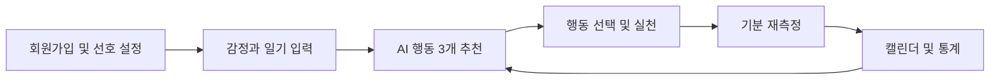
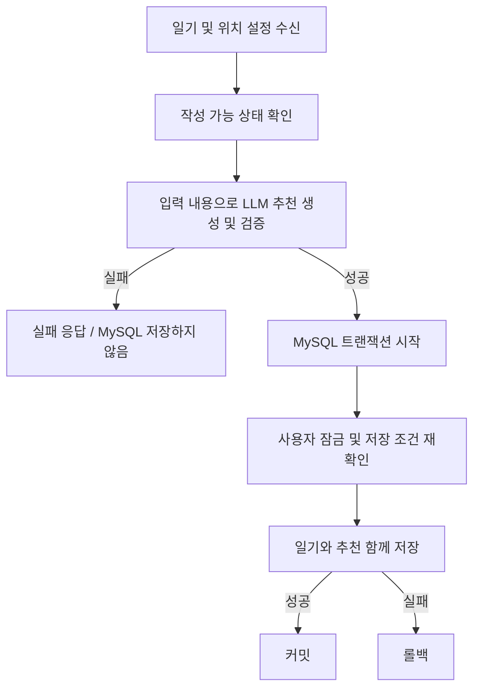
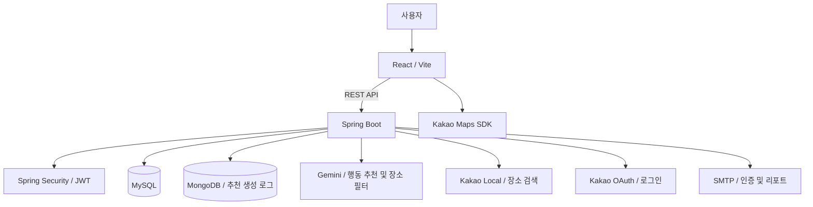

<div align="center">

# Mood & Move

### 오늘의 마음을 기록하고, 나에게 맞는 다음 행동을 찾다.

감정 기록 · AI 행동 추천 · 행동 전후 기분 변화 · 개인화 통계


[서비스 소개](#서비스-소개) · [주요 기능](#주요-기능) · [핵심 설계](#핵심-설계) · [로컬 실행](#로컬-실행)

</div>

---

## 서비스 소개

**Mood & Move는 감정 기록을 작은 실천으로 연결하는 AI 기반 웰니스 서비스입니다.**

사용자가 감정과 일기를 입력하면 현재 상황에 맞는 행동 세 가지를 제안합니다. 행동 후에는 기분을 다시 기록하고, 그 변화가 다음 추천의 개인화 자료로 사용됩니다.

단순히 좋은 활동을 나열하는 데서 그치지 않고, **내가 실제로 해 본 행동과 그 이후의 변화**를 돌아볼 수 있도록 만들었습니다.

| 구분      | 내용                                                       |
|-----------|------------------------------------------------------------|
| 프로젝트  | 3인 팀  프로젝트                                       |
| 팀원      | 이래원 · 백기완 · 장준호                                   |
| 기간      | 9월 29일 ~ 10월 16일                                       |
| 핵심 흐름 | 기록 → 추천 → 행동 선택 → 재측정 → 통계 → 다음 추천에 반영 |

## 주요 기능

| 단계 | 기능 | 사용자 경험                                                                                                              |
|------| --- |--------------------------------------------------------------------------------------------------------------------------|
| 01   | 회원가입·로그인 | 이메일 중복 확인 및 인증, 일반 로그인, 카카오 로그인                                                                     |
| 02   | 온보딩 | 기본 정보, 취미, 활동 환경·성향·동행 선호, 평소 가능 시간 설정                                                           |
| 03   | 감정 기록 | 감정과 강도, 현재 활동, 일기 및 위치 사용 방식 입력                                                                      |
| 04   | AI 행동 추천 | 일기에 명시한 상황을 우선으로 반영한 행동 세 가지 제안                                                                   |
| 05   | 주변 장소 조회 | 추천 행동과 연결된 시설을 기준 위치 5km 이내에서 최대 다섯 곳 조회                                                       |
| 06   | 기분 재측정 | 선택한 행동의 실행 후 점수를 입력하고 행동 전후 변화 확인                                                                |
| 07   | 캘린더·통계 | 월별 감정 분포, 일별 전후 점수, 실행 빈도와 카테고리별 변화 확인                                                         |
| 08   | 마이페이지 | 프로필·취미·선호 수정, 비선호 행동 관리, 회원탈퇴                                                                        |
| 09   | 월간 리포트 | 지난달 통계와 AI 응원 메시지를 담은 이메일 리포트                                                                        |
| 10   | JWT 인증 | 로그인 시 JWT를 발급해 쿠키에 저장하고, 전역 인증 구조를 통해 사용자 인증 및 접근 권한 처리                            |
| 11   | 주변 장소 추천 개선 | 추천 행동과 연결된 시설을 기준 위치 반경 5km 이내에서 최대 5곳까지 조회                                                  |


### 서비스 이용 흐름



## 핵심 설계

### 1. 일기의 현재 상황을 우선하는 추천

일기에 적은 행동, 일정, 장소, 동행 조건, 작성 시간을 우선적으로 반영하도록 프롬프트를 구성했습니다. 취미와 과거 행동 효과는 추천을 구체화하는 보조 자료로 사용하고, 평소 가능 시간은 일기에 시간 조건이 없을 때 참고합니다.

- **입력:** 감정·강도·현재 활동·일기, 온보딩 선호, 비선호 행동, 카테고리별 점수와 표본 수
- **출력:** 행동명, 카테고리, 소요 시간, 활동 환경·동행·성향, 추천 이유, 장소 검색 정보
- **서버 검증:** 허용 카테고리와 속성, 소요 시간, 장소 정보, 중복 및 비선호 행동 검사

취미와 행동 카테고리는 별개의 개념입니다. 취미는 사용자 선호이고, 행동 카테고리는 실행 결과를 집계하는 기준입니다.

### 2. 재측정 결과를 활용하는 개인화

행동 선택 횟수 대신 **완료된 기분 재측정 표본**을 활용합니다. 카테고리별 평균 변화량과 긍정 변화 비율, 표본 수를 바탕으로 개인화 점수를 계산하고 추천 요청에 포함합니다.

| 유효 표본 수 | 추천 모드 | 활용 방향 |
|--------------| --- | --- |
| 0~3개        | `COLD_START` | 현재 상황과 선호를 중심으로 탐색 |
| 3~10개       | `HYBRID` | 현재 상황·선호와 초기 행동 효과를 함께 참고 |
| 11개 이상    | `PERSONALIZED` | 누적된 카테고리별 행동 효과를 활용 |

이 과정은 모델을 재학습하는 방식이 아니라, **누적 통계를 다음 LLM 요청의 맥락으로 전달하는 방식**입니다. 개인화 점수가 높더라도 일기에 명시한 의도를 무조건 대체하지 않도록 설계했습니다.

### 3. 일기와 추천을 함께 저장하는 트랜잭션

추천 생성에 실패했는데 일기만 남는 상황을 방지하기 위해, LLM 호출과 데이터 저장 단계를 분리했습니다.



LLM 응답을 기다리는 동안에는 DB 트랜잭션을 열지 않습니다. 검증을 마친 뒤 별도 서비스의 트랜잭션에서 일기와 추천을 함께 저장합니다. MongoDB의 생성 로그는 MySQL 트랜잭션과 별도로 관리하므로 실패 원인을 추적할 수 있습니다.

### 4. 행동 추천과 주변 장소 검색의 분리

**위치 사용 안 함은 시설 방문 행동을 추천하지 않겠다는 의미가 아닙니다.** 카페 독서나 공원 산책을 추천받을 수 있으며, 사용자 위치를 이용한 주변 검색만 수행하지 않습니다.

| 위치 모드 | 검색 기준 |
| --- | --- |
| `CURRENT` | 추천 생성 시 전달받은 현재 위치 |
| `SAVED` | 추천 생성 시 기본 활동 지역의 위치 |
| `NONE` | 주변 장소 검색하지 않음 |

검색 위치는 추천 세션에 저장합니다. 이후 장소를 조회할 때도 해당 위치를 사용하며, 서버는 추천 ID를 통해 소유자와 위치 모드를 확인합니다.

- 추천에 저장한 `placeCategory`와 `placeKeyword`로 카카오 장소 검색
- 거리·장소 유형 검사 후 Gemini로 후보 필터링
- Gemini가 빈 목록을 반환하면 장소 유형·검색어 기반 규칙 필터 적용
- **검색 반경 5km, 결과 최대 5개** 유지
- 성공한 목록만 `sessionStorage`에 저장하여 새로고침 시 재사용
- 오류 또는 결과가 없을 때 ‘다시 찾아보기’로 재요청

여행은 지역 수준의 행동 제안으로 다루며 상세 장소 검색에서 제외합니다. 장소 검색 결과가 경기·공연 일정이나 예약 가능 여부를 보장하지는 않습니다.

### 5. 서비스 데이터와 추천 로그 분리

| 저장소 | 저장 대상 |
| --- | --- |
| MySQL | 회원·선호, 일기, 추천 세션, 행동 실행, 재측정, 카테고리별 통계 |
| MongoDB | 추천 생성 입력·응답, 모델·프롬프트 버전, 처리 시간, 실패 단계 등 추적 로그 |
| Flyway | MySQL 스키마와 기준 데이터의 변경 이력 |

## 기술 스택

| 영역 | 기술 |
| --- | --- |
| Backend | Java 21, Spring Boot 4.1.1, Spring Web MVC, Gradle |
| 인증·검증 | Spring Security, JWT — JJWT 0.12.6, Bean Validation |
| 데이터 접근 | Spring Data JPA, Spring Data MongoDB, Flyway |
| 기타 서버 구성 | Spring Mail, Caffeine, Lombok |
| Frontend | React 19, Vite 8, React Router 7, JavaScript, CSS |
| 시각화·UI | Recharts 3, React Hot Toast |
| Database | MySQL, MongoDB |
| 외부 연동 | Gemini API, Kakao OAuth, Kakao Local API, Kakao Maps JavaScript API, SMTP |

## 아키텍처



## 프로젝트 구조

```text
mood-and-move/
├── backend/
│   ├── src/main/java/com/moodandmove/
│   │   ├── analysis/          # 기분 변화 및 행동 효과 통계
│   │   ├── calendar/          # 월별 감정 기록
│   │   ├── common/            # 보안, 공통 타입, 예외 처리
│   │   ├── home/              # 홈 화면 데이터
│   │   ├── mail/              # 이메일 인증 및 발송
│   │   ├── mood/              # 일기 및 추천 통합 처리
│   │   ├── place/             # 주변 장소 조회 및 필터
│   │   ├── recommendation/    # 추천 생성, 실행, 재측정, 개인화
│   │   ├── report/            # 월간 리포트
│   │   └── user/              # 회원, 온보딩, 선호
│   └── src/main/resources/db/migration/
└── frontend/
    ├── public/
    └── src/
        ├── api/               # 서버 API 호출
        ├── components/        # 공통 UI
        ├── pages/             # 기능별 화면
        ├── routes/            # 라우팅 및 접근 제어
        └── utils/
```

## 로컬 실행

### 준비 사항

- JDK 21 및 프로젝트의 Vite 버전과 호환되는 Node.js 환경
- 실행 중인 MySQL과 MongoDB
- Gemini API 키와 사용할 모델명
- Kakao Developers 앱의 로그인·Local API·지도 설정
- 이메일 인증 및 리포트 발송용 SMTP 계정

### 1. 환경 변수 설정

저장소 루트의 `.env.example`을 `.env`로 복사하고 값을 설정합니다. 예제 파일에 없는 MongoDB·메일 설정 등은 함께 추가합니다.

| 변수 | 용도 |
| --- | --- |
| `API_URL` | Vite 개발 프록시 대상. 로컬 기본값 `http://localhost:8080` |
| `FRONTEND_URL` | 프론트엔드 주소. 로컬 기본값 `http://localhost:5173` |
| `DB_URL`, `DB_USERNAME`, `DB_PASSWORD` | MySQL 접속 정보 |
| `MONGODB_URI` | MongoDB 접속 URI |
| `JWT_SECRET` | JWT 서명용 비밀키 |
| `COOKIE_SECURE` | 로컬 HTTP 개발 환경에서는 `false` |
| `GEMINI_API_KEY`, `GEMINI_MODEL` | Gemini 인증 및 모델 설정 |
| `KAKAO_CLIENT_ID`, `KAKAO_CLIENT_SECRET` | 카카오 로그인 설정 |
| `KAKAO_REDIRECT_URI` | 로그인 콜백. 로컬 기본값 `http://localhost:8080/api/auth/kakao/callback` |
| `KAKAO_REST_API_KEY` | 카카오 장소 검색 인증 |
| `MAIL_USERNAME`, `MAIL_PASSWORD` | 메일 발송 계정 및 인증 정보 |

프론트엔드의 `frontend/.env.local`에는 지도용 키를 설정합니다.

```dotenv
VITE_KAKAO_MAP_JS_KEY=your_kakao_javascript_key
```

현재 장소 필터는 Gemini를 사용합니다. 별도의 `OpenAiPlaceFilter` 구현은 빈 등록이 비활성화되어 있으며, 이를 활성화하는 경우 `OPENAI_API_KEY`, `OPENAI_MODEL` 설정이 필요합니다.

> 실제 비밀키와 접속 비밀번호는 README 또는 버전 관리에 포함하지 않습니다.

### 2. 데이터베이스 준비

`DB_URL`에 지정한 MySQL 데이터베이스를 먼저 생성합니다.

```sql
CREATE DATABASE moodandmove CHARACTER SET utf8mb4;
```

MongoDB를 실행하고 `MONGODB_URI`를 설정합니다. MySQL 테이블과 기준 데이터는 백엔드 시작 시 Flyway 마이그레이션으로 구성됩니다.

### 3. 백엔드 실행

저장소 루트에서 실행합니다.

```powershell
cd backend
.\gradlew.bat bootRun
```

macOS / Linux에서는 `./gradlew bootRun`을 사용합니다.

### 4. 프론트엔드 실행

새 터미널을 열고 저장소 루트에서 실행합니다.

```powershell
cd frontend
npm ci
npm run dev
```

브라우저에서 `http://localhost:5173`에 접속합니다. 카카오 로그인과 지도 사용을 위해 개발자 콘솔의 리다이렉트 URI 및 웹 도메인 설정도 로컬 주소와 일치해야 합니다.

## 개선 과제

- **검색어 구체화:** ‘향토음식’처럼 포괄적인 표현을 실제 검색 가능한 음식·시설명으로 구체화
- **일시적 외부 API 장애 대응:** Gemini 503 응답에 대한 제한적 재시도 및 사용자 안내 개선

---

<div align="center">

**Mood & Move**  
오늘의 기록이 다음의 작은 실천으로 이어지도록.

</div>
